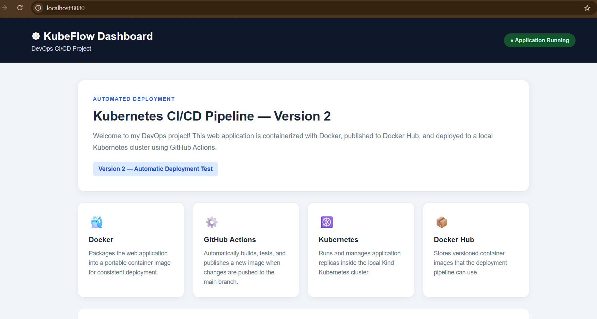
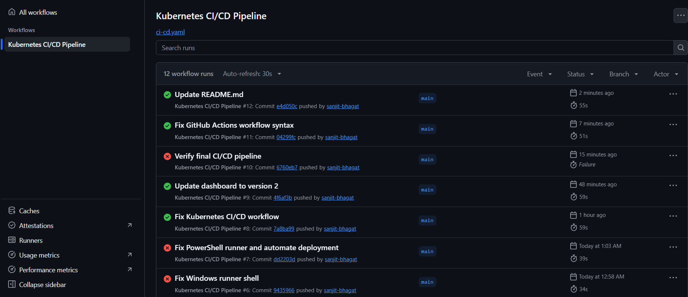
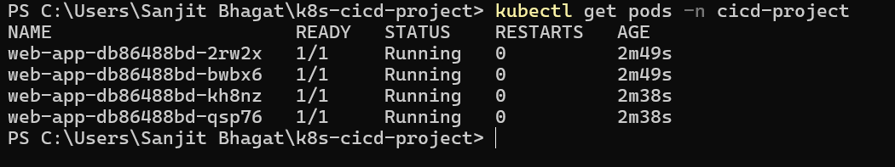

# Automated Kubernetes CI/CD Pipeline

A DevOps project that automates the build, publish, and deployment of a web application using Docker, GitHub Actions, Docker Hub, and Kubernetes.

## 📌 Project Overview

This project demonstrates how to build a Dockerized web application, publish the image to Docker Hub, and deploy it to a local Kubernetes cluster using a GitHub Actions CI/CD pipeline.

The application is a **KubeFlow Dashboard** built with HTML and CSS and served using Nginx.

## 🛠️ Tools and Technologies

- **Git & GitHub** — Source code management
- **Docker** — Containerization
- **Docker Hub** — Docker image registry
- **GitHub Actions** — CI/CD automation
- **Kubernetes** — Container orchestration
- **Kind** — Local Kubernetes cluster
- **Nginx** — Web server
- **YAML** — Workflow and Kubernetes configuration
- **PowerShell** — Local Windows environment

## 🖥️ Project Screenshots

### 1. Application Dashboard

The KubeFlow Dashboard running in the browser.



### 2. GitHub Actions CI/CD Pipeline

The GitHub Actions workflow successfully completed.



### 3. Kubernetes Deployment

All four application pods running successfully in the `cicd-project` namespace.



## 🏗️ Project Architecture

1. Developer pushes code to the GitHub repository.
2. GitHub Actions starts the CI/CD workflow.
3. The workflow builds the Docker image.
4. The image is published to Docker Hub.
5. The deployment job updates the Kubernetes Deployment.
6. Kubernetes maintains four application replicas.
7. The application is accessed through Kubernetes port forwarding.

## ⚙️ CI/CD Workflow

The GitHub Actions workflow is stored at:

`.github/workflows/ci-cd.yaml`

The pipeline includes:

- Automated workflow execution on code changes.
- Docker image build.
- Image publishing to Docker Hub.
- Deployment to the local Kind Kubernetes cluster.
- Kubernetes rollout verification.

The deployment job uses a **self-hosted Windows runner** to access the local Kubernetes cluster.

## ☸️ Kubernetes Features

- Deployment with four replicas.
- Service for application access.
- Namespace isolation using `cicd-project`.
- Startup, liveness, and readiness probes.
- CPU and memory resource requests and limits.
- Rolling deployment updates through Kubernetes.

## 📂 Project Structure

```text
k8s-cicd-project/
├── .github/
│   └── workflows/
│       └── ci-cd.yaml
├── app/
│   └── index.html
├── k8s/
│   ├── deployment.yaml
│   └── service.yaml
├── screenshots/
│   ├── application-dashboard.png
│   ├── github-actions-success.png
│   └── kubernetes-pods.png
├── Dockerfile
└── README.md
```

## 🚀 Run the Project Locally

### Prerequisites

Install and configure:

- Docker Desktop
- kubectl
- Kind
- Git

### 1. Clone the repository

```bash
git clone https://github.com/sanjit-bhagat/k8s-cicd-project.git
cd k8s-cicd-project
```

> This repository is private, so you must have GitHub access to clone it.

### 2. Create the Kind cluster

If the cluster does not already exist:

```bash
kind create cluster --name devops-cluster
```

### 3. Create the Kubernetes namespace

```bash
kubectl create namespace cicd-project
```

If the namespace already exists, you can skip this step.

### 4. Deploy the application

```bash
kubectl apply -f k8s/deployment.yaml
kubectl apply -f k8s/service.yaml
```

Check the deployment:

```bash
kubectl get pods -n cicd-project
kubectl get deployments -n cicd-project
kubectl get services -n cicd-project
```

Wait for the rollout:

```bash
kubectl rollout status deployment/web-app -n cicd-project
```

### 5. Access the application

```bash
kubectl port-forward service/web-app-service 8080:80 -n cicd-project
```

Open the following URL in your browser:

`http://localhost:8080`

Keep the PowerShell terminal running while accessing the application.

## 🔐 GitHub Secrets

Configure these repository secrets under **Settings → Secrets and variables → Actions**:

| Secret | Purpose |
|---|---|
| `DOCKERHUB_USERNAME` | Docker Hub username |
| `DOCKERHUB_TOKEN` | Docker Hub access token |

Never commit access tokens or other credentials to the repository.

## 🏃 Self-Hosted Runner

The deployment job uses a Windows self-hosted runner with access to the local Kind cluster.

For automatic deployment to work:

- The runner must be online.
- Docker Desktop and the Kind cluster must be running.
- `kubectl` must be configured for the correct cluster context.
- The runner must have the required permissions.

The runner can be unavailable when your computer is switched off or asleep.

## 📚 What I Learned

- Building and running Docker images.
- Publishing container images to Docker Hub.
- Creating GitHub Actions CI/CD workflows.
- Deploying applications to Kubernetes.
- Managing Deployments, Services, and namespaces.
- Configuring health probes and resource limits.
- Automating application updates.
- Troubleshooting CI/CD and Kubernetes deployment issues.

## 🔮 Future Improvements

- Add automated application tests.
- Add monitoring and logging.
- Deploy to a cloud Kubernetes service.
- Configure Ingress and HTTPS.
- Improve security and image scanning.

## 👨‍💻 Author

**Sanjit Bhagat**

BSc Information Technology | Aspiring DevOps Engineer

[GitHub](https://github.com/sanjit-bhagat)

[LinkedIn](https://linkedin.com/in/sanjit-bhagat-39a9302a7/)
